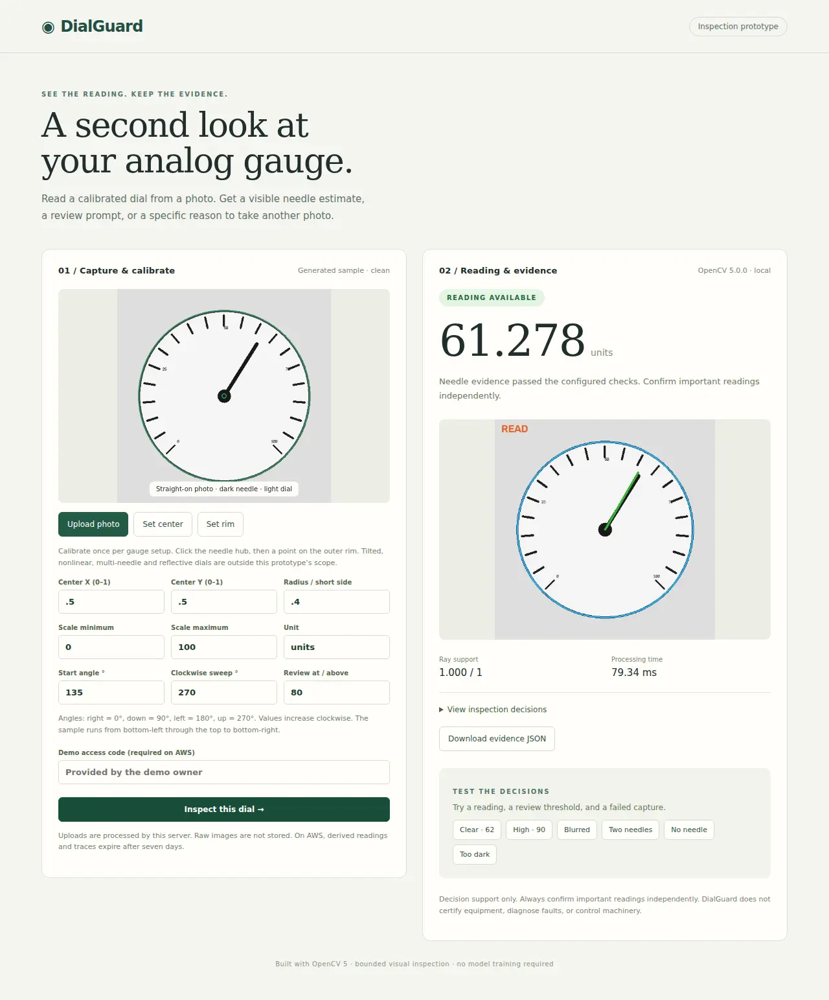
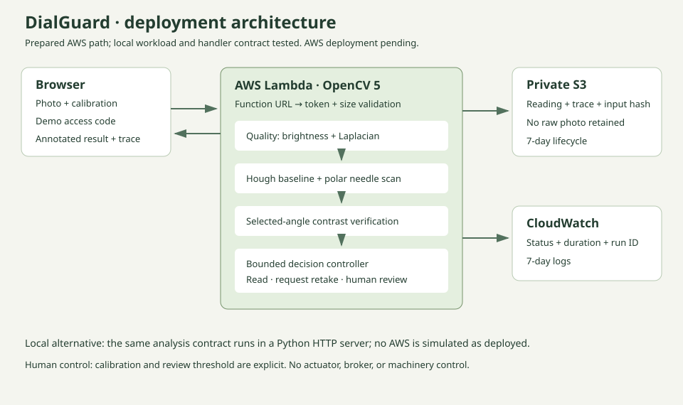

# DialGuard — evidence-first analog gauge inspection

A small OpenCV 5 application that reads a **manually calibrated, frontal, linear analog dial**, draws its needle estimate, and requests another photo or human review when the configured evidence checks fail.

This is the first executable MVP for the OpenCV AI Competition 2026. **It is not a completed competition submission.** AWS deployment, broader real-photo evaluation, and the team/demo video are still required. There is no claim of prize likelihood or field accuracy.



## Run the complete local application

Python 3.12 is the tested runtime. From this directory:

```sh
python -m venv .venv
# macOS/Linux
. .venv/bin/activate
# Windows alternative: .venv\Scripts\Activate.ps1
python -m pip install -r requirements-dev.txt
python -m dialguard.server
```

Open **http://127.0.0.1:8080**. Inspect the generated sample, try the high-reading and failed-capture examples, or upload a PNG/JPEG photo. Set the needle hub and rim, enter the scale, and inspect. Numeric calibration controls provide an alternative to mouse clicks. Raw photos remain in memory; they are not saved by the application.

The gauge must have a dark needle on a light face, an increasing clockwise linear scale, and an approximately frontal camera view. Counterweights, strong lettering in the sampled needle region, reflections, tilted views, nonlinear scales, multiple needles, and wrong calibration can cause rejection **or incorrect acceptance**. Ray support is not a calibrated probability of correctness. Confirm important readings independently.

## Verify

```sh
python -m pytest -q
python scripts/evaluate.py
# While the local server is running, in another terminal:
python scripts/smoke_http.py
# Optional browser verification (Node 22+):
npm install
npx playwright install chromium
npm run test:browser
```

The core uses **opencv-python-headless 5.0.0.93**, whose runtime reports OpenCV **5.0.0**. A version guard refuses OpenCV 4. Dependencies are pinned. The browser uses the same analysis contract as AWS; there are no LLM calls, downloaded models, or GPU requirements.

## First measured result

The committed [procedural benchmark](evidence/benchmark.json) contains 128 generated images and per-case seeds, hashes, truths, results, and timing. It accepted 79/80 clear/noisy images with mean absolute error 0.557 scale units on a 0–100 dial, and rejected all 48 deliberately blurred/dark/missing/ambiguous images. One clear fixture was rejected. These are **development fixture results, not field-validation results**. The Hough baseline is slightly more accurate on readable fixtures; DialGuard's proposed value is selective acceptance, observable decisions, and human control, not a demonstrated accuracy improvement.

An independently sourced public-domain real photo is also included as an exploratory rejected case, with attribution and limitations in [the evaluation notes](docs/EVALUATION.md). It has no verified instrument ground truth and is not included in the benchmark metric.

## AWS path

The [SAM template](template.yaml) deploys a Lambda container that executes the actual OpenCV 5 inspection, serves the web UI, and writes derived evidence to a private encrypted S3 bucket with seven-day expiration. CloudWatch receives only run IDs, statuses, latency, and OpenCV version. A demo access code gates inspections. Two reserved concurrent executions limit bursts; this is **not a spending cap**. See the [deployment guide](docs/AWS.md).



## Reviewable evidence

- [Project choice and repository audit](docs/DECISION.md)
- [Technical report](docs/TECHNICAL_REPORT.md)
- [Evaluation, known failures, and next protocol](docs/EVALUATION.md)
- [Current competition requirements and completion checklist](docs/SUBMISSION.md)
- [Verification record](docs/VERIFICATION.md)
- [Four-minute video outline](docs/VIDEO.md)

The bounded controller uses image results to select a refinement tool window and to change the subsequent action. This is not an LLM agent; Agentic Vision award eligibility has not been confirmed. COOL is not used or claimed.

The directory is self-contained: copy it into a new repository without changing imports or build paths. It is isolated in `ai-work-samples`, which already houses standalone demonstrations; existing nail, trading, and plugin repositories were not repurposed. Produced with AI coding assistance. Human review and contest submission have not been claimed.
